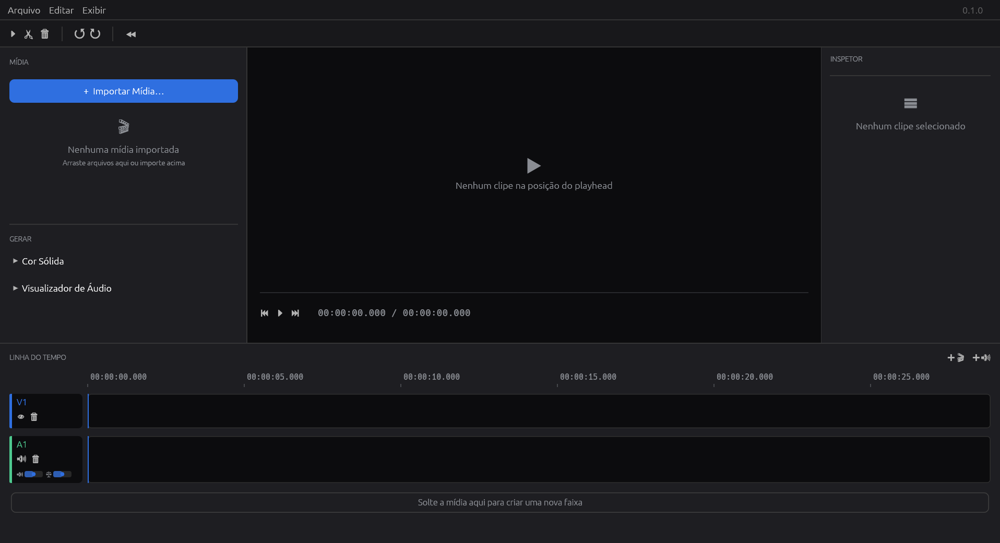
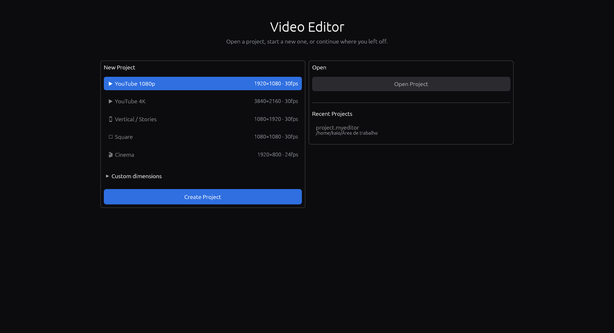
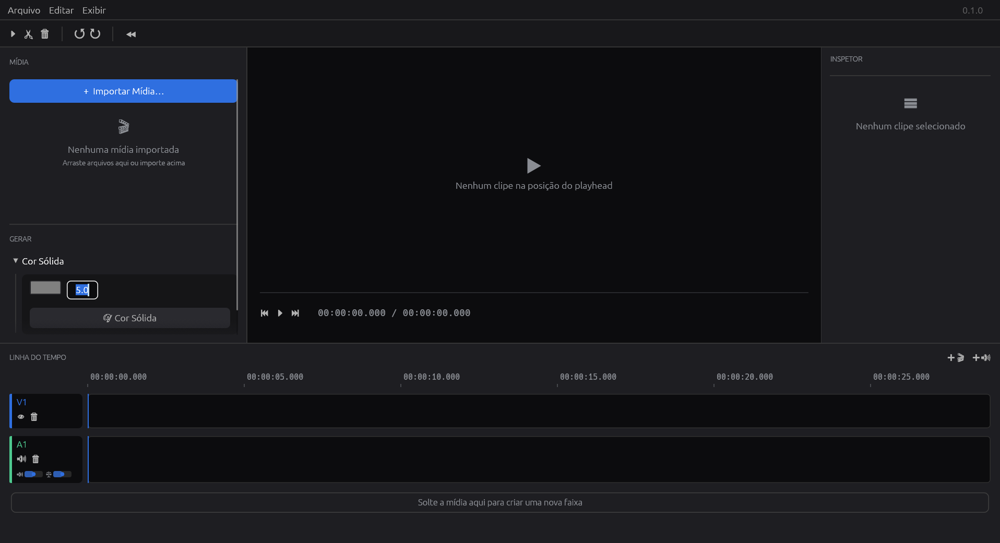
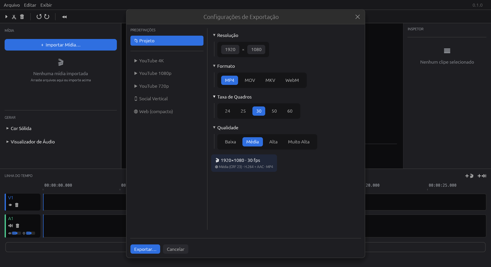

# Editor de Vídeo em Rust

Editor de vídeo desktop simples e modular, escrito em Rust (egui/eframe), com timeline multi-track, composição em tempo real, export para MP4/MOV/MKV/WebM e atalhos de teclado personalizáveis.



## Como rodar

Requisitos: Rust stable (edition 2024). No Linux, as dependências de áudio (ALSA) já vêm vendorizadas no repositório — nenhum pacote de sistema extra é necessário.

```bash
cargo run                    # compila e abre a janela do editor
```

Na primeira execução, o app baixa automaticamente um `ffmpeg`/`ffprobe` estático (necessário pra importar/decodificar/exportar mídia) — não bloqueia a abertura da janela, só some no fundo em segundo plano.

Outros comandos úteis:

```bash
cargo build                              # só compila
cargo fmt                                # formata
cargo clippy --all-targets               # lint
cargo test                               # roda os testes
```

## Documentação

- [CLAUDE.md](CLAUDE.md) — especificação técnica completa: arquitetura, modelo de dados, pipeline de preview/export e roadmap por fases.
- [CONTRIBUTING.md](CONTRIBUTING.md) — como preparar o ambiente, convenções e como enviar um pull request.

## Contribuindo

Contribuições são bem-vindas. Leia o [CONTRIBUTING.md](CONTRIBUTING.md) antes de abrir um pull request. Bugs e ideias grandes podem ser discutidos em uma issue antes do código.

## Licença

Distribuído sob a [licença MIT](LICENSE).

Dependências de terceiros mantêm as próprias licenças. Os headers do ALSA vendorizados em `vendor/alsa/` são LGPL-2.1, detalhes em [vendor/alsa/NOTICE.md](vendor/alsa/NOTICE.md). O `ffmpeg`/`ffprobe` baixado na primeira execução tem licença própria (ver o build distribuído pelo `ffmpeg-sidecar`).

## Funcionalidades

### Tela de boas-vindas

Ao abrir o app, a tela de boas-vindas pede pra escolher entre criar um projeto novo ou continuar um existente antes de mostrar o editor. **Novo Projeto** (coluna esquerda) tem templates prontos (YouTube 1080p/4K, Vertical/Stories, Quadrado, Cinema) ou dimensões/fps customizados — a resolução escolhida aqui já sai coerente com a exportação (as configurações de export nascem espelhando o projeto, em vez de sempre partir do 1920x1080 genérico). **Abrir**/**Projetos Recentes** (coluna direita) reabrem um `.myeditor` existente, com a lista de recentes persistindo entre sessões. **Arquivo → Novo Projeto...** reabre essa tela a qualquer momento sem reiniciar o app.



### Importar mídia

Clique em **+ Importar Mídia...** no painel esquerdo, ou arraste arquivos direto pra dentro do painel. Vídeo, áudio e imagens são aceitos (outros formatos são rejeitados no seletor). Se um arquivo referenciado por um projeto salvo não for mais encontrado, um botão "Localizar arquivo…" aparece pra reconectá-lo.

### Timeline

Arraste um item da lista de mídia pra uma faixa da timeline (ou clique no ícone **+** ao lado dele pra adicionar automaticamente). Se não existir nenhuma faixa do tipo certo (vídeo/áudio), solte a mídia na faixa "Solte a mídia aqui para criar uma nova faixa", no rodapé da timeline — uma faixa nova é criada na hora. Os botões ➕🎬/➕🔊 no canto superior direito da timeline também criam faixas manualmente.

- **Selecionar**: clique num clipe. Shift+clique estende a seleção.
- **Mover**: arraste o clipe pelo meio.
- **Trim**: arraste a borda esquerda/direita do clipe.
- **Split**: posicione o playhead sobre o clipe e use o atalho de Dividir (padrão `S`) ou o botão de tesoura na barra de ferramentas.
- **Reverter**: botão ⏪ na barra de ferramentas, ou menu de contexto do clipe (botão direito).
- **Zoom**: Ctrl+scroll sobre a timeline, ancorado no cursor.

### Fade e opacidade/volume direto no clipe

Cada clipe tem duas alcinhas diagonais nos cantos superiores — arraste pra dentro do clipe pra ajustar `fade in`/`fade out` visualmente. Uma linha horizontal no meio do clipe controla opacidade (vídeo) ou volume (áudio) — arraste pra cima/baixo pra ajustar diretamente, sem abrir o Inspector.

### Faixas de áudio: volume e balanço

O cabeçalho de cada faixa de áudio tem dois controles rápidos (🔊 volume, ⚖ balanço) — clique ou arraste na barra pra ajustar. O Inspector (clique no cabeçalho da faixa) tem os mesmos controles com valor exato, mais mute/visibilidade.

### Geradores (Cor Sólida / Visualizador de Áudio)

No painel esquerdo, abra os cards **Cor Sólida** ou **Visualizador de Áudio** em "Gerar" pra criar uma camada sem precisar de um arquivo — cor, duração, altura, margem, cor das barras etc. são configuráveis antes e depois de adicionar à timeline (o Inspector mostra os mesmos controles quando o clipe gerado está selecionado).



### Preview

O player central mostra o resultado composto (todas as faixas de vídeo sobrepostas, com opacidade/fade aplicados) no instante do playhead. Play/Pause, avançar/voltar frame a frame, e o tempo atual/total ficam na barra de controles abaixo do preview.

### Desfazer/Refazer

`Ctrl+Z` / `Ctrl+Shift+Z` (ou os atalhos configurados nas Preferências) desfazem/refazem qualquer edição na timeline.

### Exportar

`Ctrl+E` ou **Arquivo → Exportar...** abre o diálogo de exportação: escolha um preset (YouTube 4K/1080p/720p, Social Vertical, Web Compacto) ou ajuste manualmente resolução, **formato** (MP4, MOV, MKV ou WebM), taxa de quadros e qualidade. O resumo no rodapé mostra exatamente o que vai ser gerado antes de confirmar.



### Preferências e atalhos de teclado

**Editar → Preferências...** abre a tela de atalhos configuráveis. A coluna esquerda lista presets prontos (Padrão, Vegas, Premiere, CapCut) que substituem todos os atalhos de uma vez — cada um só usa combinações confirmadas na documentação real de cada editor. Qualquer atalho individual pode ser reatribuído clicando nele e pressionando a nova combinação de teclas.

### Idioma

**Exibir → Idioma** troca o idioma da interface em tempo real (10 idiomas suportados: en, pt-BR, es, zh-CN, ja, hi, id, fr, it, de).
